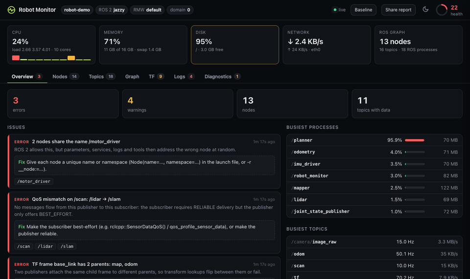
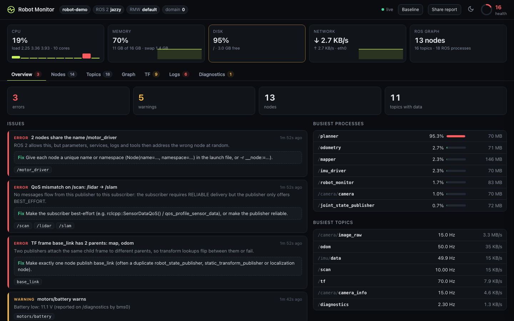
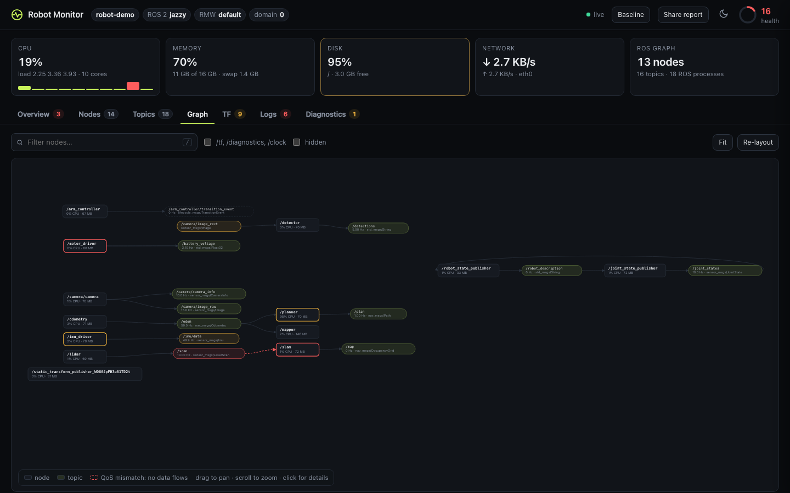
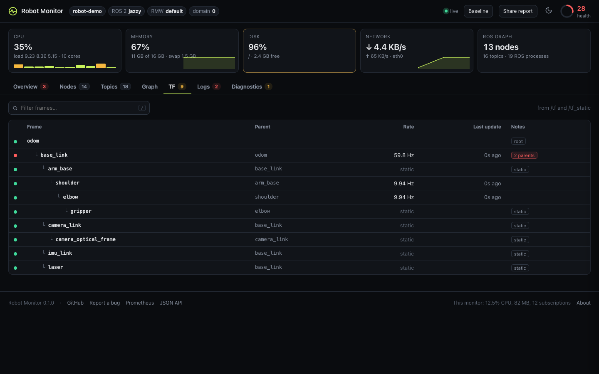

# Robot Monitor

**See what your ROS 2 robot is really doing, in one command.**

Robot Monitor finds every node, maps it to the process that runs it (CPU, memory, restarts), measures every topic (rate, bandwidth, latency), and tells you in plain words what is broken and how to fix it: QoS mismatches, mistyped topic names, duplicate node names, stalled sensors, CPU-starved nodes, memory leaks, under-voltage. It runs on the robot, opens a live dashboard in your browser, and needs no configuration, no account and no internet.



```bash
ros2 run robot_monitor robot_monitor
# Robot Monitor dashboard: http://localhost:9191  http://192.168.1.42:9191
```

Try it on a demo robot full of typical bugs:

```bash
ros2 launch robot_monitor demo.launch.py
```

## What it finds

| Problem | What you see |
|---|---|
| **QoS mismatch** (the #1 "my subscriber gets nothing" bug) | `QoS mismatch on /scan: /lidar → /slam` — *the subscriber requires RELIABLE delivery but the publisher only offers BEST_EFFORT.* Fix: use `SensorDataQoS` … |
| **Mistyped topic name** | `Nobody publishes /camera/image_rect — did you mean /camera/image_raw?` |
| **Duplicate node names** | `2 nodes share the name /motor_driver` |
| **Same topic, different types** | `/cmd is used with 2 different types` |
| **Stalled or slow topics** | `/imu/data stopped publishing` (learned 100 Hz, silent 6 s) · `/scan is slow: 6 Hz instead of 10 Hz` |
| **A node eating a whole core** | `/planner is saturating a CPU core (96%)` |
| **Memory leaks** | `Memory of /mapper keeps growing (+12 MB/min)` |
| **Crashes and respawns** | `Node /driver restarted 3 times` · `Node /camera disappeared` |
| **TF problems** | `TF frame base_link has 2 parents: map, odom` · `Transform odom → base_link stopped updating` |
| **Clock problems between machines** | `/odom is stamped in the future` (clocks out of sync) |
| **Hardware and OS** | under-voltage (Raspberry Pi), throttling, temperature, memory, disk full |
| **Your own diagnostics and logs** | every `/diagnostics` WARN/ERROR and nodes that log errors, in one place |
| **Discovery problems** | `No other ROS nodes are visible` with your `ROS_DOMAIN_ID`, RMW and discovery range |

Rules are conservative on purpose: event-driven topics are never called "stale", latched topics are understood, and time-based rules wait before they fire.

## The dashboard

- **Overview**: health score, issues with a fix for each, busiest processes and topics, recent crashes.
- **Nodes**: every node with its PID, CPU (and history), memory, publishers and subscribers, lifecycle state, restarts. Works for composable nodes too.
- **Topics**: rate, rate history, bandwidth, message size, latency (header stamp → arrival), publishers → subscribers, QoS per endpoint, and the latest message on request.
- **Graph**: a readable left-to-right graph of nodes and topics; broken QoS links are drawn in red. Click anything for details.
- **TF**: the live TF tree with each frame's parent, rate and last update; static frames marked. Flags frames with two parents, transforms that stopped updating and trees that are split apart.
- **Node details**: process, CPU and memory history, publishers and subscribers, services and actions, and the node's parameters (read on request).
- **Logs**: live `/rosout` from every node, filter by level, node or text.
- **Diagnostics**: everything published on `/diagnostics`, grouped.
- **Share report**: one click gives a Markdown health report to paste into a GitHub issue or ROS Discourse question.
- **Baseline**: save "this is what normal looks like" (nodes and topic rates). From then on a missing node or a slow topic is an error, even after a reboot.







## In the terminal and in CI

```bash
ros2 monitor check                 # observe for a few seconds, print problems, exit 1 on errors
ros2 monitor check --format md     # Markdown, for issues and chat
ros2 monitor check --baseline ~/.ros/robot_monitor/baseline.yaml --fail-on warn
ros2 monitor check --expect-nodes /lidar /camera/driver
ros2 monitor top                   # htop for ROS nodes
ros2 monitor                       # the web dashboard
```

`check` is made for launch tests and CI: start your stack, run `ros2 monitor check --baseline robot.yaml`, and the job fails if a node is missing, a topic is slow or a QoS mismatch appears.

## Install

From source (any ROS 2 distro from Humble on):

```bash
mkdir -p ~/robot_monitor_ws/src && cd ~/robot_monitor_ws/src
git clone https://github.com/PhysicalFleet/robot_monitor.git
cd .. && rosdep install --from-paths src -y --ignore-src
colcon build --packages-select robot_monitor
source install/setup.bash
ros2 run robot_monitor robot_monitor
```

From apt (once released): `sudo apt install ros-$ROS_DISTRO-robot_monitor`.

Run it next to your robot's launch file:

```bash
ros2 launch robot_monitor robot_monitor.launch.py port:=9191
```

or add it to your own launch file:

```python
Node(package='robot_monitor', executable='robot_monitor', name='robot_monitor')
```

## How it works

- **Node → process mapping without instrumentation.** ROS 2 has no API for "which PID runs this node". Robot Monitor combines several clues and shows which one it used:
  - the process ID that Fast DDS embeds in DDS GUIDs, calibrated at runtime against Robot Monitor's own GUID, so nothing vendor-specific is hard-coded and nodes on other machines are recognised;
  - DDS discovery announcements (SPDP), which list the UDP ports each participant listens on, matched against the sockets each process owns. This works for any DDS vendor, including Cyclone DDS, and gives the IP address of nodes on other machines. The listener only reads multicast copies and never sends anything;
  - `__node:=` remaps on command lines, composition containers (`_container/list_nodes`), ROS log files, executable names, and nodes that share a DDS participant (this is how it handles Zenoh).
- **Topic statistics without deserializing.** Robot Monitor subscribes with raw (serialized) messages: rate, bandwidth and size come from arrival times and byte counts, and latency comes from the header stamp read directly from the CDR bytes. That is a few microseconds of work per message, even for images and point clouds.
- **It protects your robot.** Large or fast topics are sampled (a few seconds in every ten) instead of received continuously, and so is everything above a total message budget (`max_total_rate_hz`). When nobody has the dashboard open it refreshes every 3 s instead of every second. It shows its own CPU and memory in the footer. On a Raspberry Pi 4 with 11 nodes and about 30 topics it uses about 10% of one core (an 8-hour run averaged 9.2%), with memory steady at under 90 MB.
- **Read-only.** It never calls a service that changes anything, never sets parameters and never publishes anything except its findings on `/diagnostics`. Parameters and the latest message are read only when you ask for them in the dashboard.

## Integrations

- **`/diagnostics`**: findings are published as `diagnostic_msgs/DiagnosticArray` (`robot_monitor: …`), so they appear in `rqt_robot_monitor`, `diagnostic_aggregator` and Foxglove. Disable with `publish_diagnostics:=false`.
- **Prometheus**: `http://<robot>:9191/metrics` (health score, issues, topic rates and bandwidth, per-node CPU and memory, host metrics).
- **JSON**: `http://<robot>:9191/api/snapshot`, plus `/api/logs`, `/api/report?format=md`, `/api/echo?topic=<name>` (latest message) and `/api/params?node=<name>`.

## Parameters

| Parameter | Default | Meaning |
|---|---|---|
| `port` | `9191` | Dashboard port (tries the next 9 if it is busy) |
| `host` | `0.0.0.0` | Listen address; `127.0.0.1` keeps the dashboard local to the robot |
| `refresh_period` / `idle_period` | `1.0` / `3.0` | Seconds between refreshes with / without someone watching |
| `monitor_topics` | `true` | Subscribe to topics to measure them |
| `exclude_topics` | `[""]` | Regexes of topics never subscribed to |
| `sample_heavy` | `true` | Sample large or fast topics |
| `heavy_bandwidth_mb` / `max_rate_hz` | `8.0` / `1500` | Per-topic thresholds for sampling |
| `max_total_rate_hz` | `1000` | Total received messages per second before the busiest topics are sampled |
| `publish_diagnostics` | `true` | Publish findings on `/diagnostics` |
| `baseline_file` | `~/.ros/robot_monitor/baseline.yaml` | Expected nodes and topic rates |

## Security

The dashboard is read-only and has no login. By default it listens on all interfaces so you can open it from a laptop on the robot's network. It shows node names, topic names, process command lines (secret-looking arguments such as `--token` or `password:=` are masked) and ROS environment variables. On a network you don't trust, run it with `host:=127.0.0.1` and use an SSH tunnel: `ssh -L 9191:localhost:9191 robot`.

## Supported

- ROS 2 Humble, Jazzy, Kilted, Lyrical and Rolling. Tested in CI on each.
- Fast DDS, Cyclone DDS and Zenoh.
- Linux for process and host metrics (x86_64 and arm64, including Raspberry Pi and NVIDIA Jetson; NVIDIA GPU memory per process). On other systems, the graph and topic features still work.
- Any browser. The dashboard is plain HTML and JavaScript served by the robot, with no external fonts or scripts, so it works offline.

## Contributing

Issues and pull requests are welcome. Run the tests with `colcon test --packages-select robot_monitor && colcon test-result --verbose`. See [CONTRIBUTING.md](CONTRIBUTING.md).

## License and maintainers

Apache-2.0. Developed and maintained by [PhysicalFleet](https://physicalfleet.io/).

PhysicalFleet builds infrastructure to deploy, monitor, debug and continuously improve intelligent machines, from the first device to millions: humanoids and robot dogs, arms and tractors, delivery bots and excavators, and the models they run, from RL policies to VLAs. The platform covers fleet management, observability, alerts and anomaly detection, over-the-air updates and security for machines in production. Robot Monitor is a free, standalone tool from the same team: it needs no account and connects to nothing.
